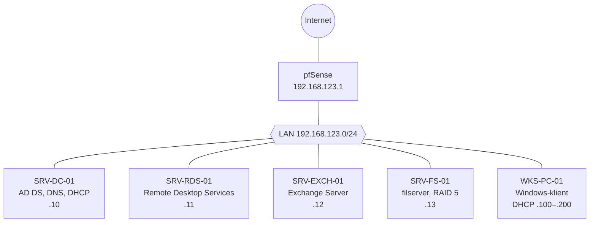

# Project Success – AD, filserver, RDS och Exchange

En komplett Windows-infrastruktur för 150 användare, byggd på en vecka i Hyper-V: Active Directory, en filserver med RAID, Remote Desktop Services och Exchange med två e-postdomäner. Projektet gjordes i Exchange-kursen, vecka 5 (26 januari–2 februari 2026).

**Typ:** gemensamt grupparbete med tre gruppmedlemmar, där alla deltog i alla delar. Jag var **teamleader** och hade huvudansvar för **Active Directory**.

> Domänerna `super.net` och `lalatrix.se` är fiktiva och användes bara i labbet.

## Mål

- AD-server med användarna från en CSV-fil, Folder Redirection för alla och nätverksenheten `P:\Shared`.
- Delade mappar för Public, Sales, Marknad och IT, där varje avdelning bara ser sin egen mapp, på en RAID-disk.
- RDS-server med Office 2013 för alla användare, bara åtkomlig i LAN.
- Exchange på en annan RAID-disk än `C:\`, med adresser enligt `förnamn.efternamn@domän`, delade mailboxar, resursmailboxar och e-post till och från andra domäner.
- En domänansluten Windows-klient med Office 2013, där Outlook fungerar både i och utanför LAN.

## Arkitektur

| VM | Roll | IP-adress | Systemdisk |
| --- | --- | --- | --- |
| pfSense | Brandvägg | 192.168.123.1 | 20 GB |
| SRV-DC-01 | AD DS, DNS, DHCP | 192.168.123.10 | 60 GB |
| SRV-RDS-01 | Remote Desktop Services | 192.168.123.11 | 50 GB |
| SRV-EXCH-01 | Exchange Server | 192.168.123.12 | 80 GB |
| SRV-FS-01 | Filserver | 192.168.123.13 | 60 GB |
| WKS-PC-01 | Windows-klient | DHCP 192.168.123.100–200 | 40 GB |

## Active Directory

- Domänen `super.net`. SRV-DC-01 sköter inloggning, DNS och grupprinciper.
- OU-strukturen skapades med [`Create-OUs.ps1`](scripts/Create-OUs.ps1): rot-OU `Super` med `Clients` (Workstations, Servers), `Users`, `Admins`, `ServiceAccounts` och `Groups` (Security, Distribution).
- 150 användare importerades med [`Import-Users.ps1`](scripts/Import-Users.ps1). Skriptet skapar en OU och en säkerhetsgrupp per avdelning, lägger användaren där och sätter avdelning och kontor.
- Användarnamnen byggs som `anställningsnummer_förnamn`, till exempel `1018_frederick`. Det gör dem unika även om två personer heter samma sak.

## Filserver

| Del | Lösning |
| --- | --- |
| Lagring | Operativsystemet på en egen disk. Data på en RAID 5-volym, som klarar att en disk går sönder och ger mer användbart utrymme än RAID 1. |
| Mappar | `D:\Shared` med `Public`, `Sales`, `Marknad` och `IT`, samt `D:\RedirectedFolders` |
| Grupper | Globala grupper (`GG_Sales`) i domänlokala grupper (`DL_Sales`), som får behörigheten |
| Utdelning | Access-Based Enumeration på, *Encrypt data access* på |
| NTFS | Arvet avstängt. `DL_<avdelning>` har Modify, och IT har Full Control på IT-mappen. Public: Domain Users Modify. |
| Folder Redirection | Dokument och Skrivbord till `\\SRV-FS-01\RedirectedFolders\%USERNAME%`. Domain Users får bara skapa mappar i roten, så ingen ser någon annans mapp. |
| Nätverksenhet | GPO med Drive Maps: `P:` → `\\SRV-FS-01\Shared` |

| Avdelning | Ser mapparna |
| --- | --- |
| Sales | Public, Sales |
| Marknad | Public, Marknad |
| IT | Public, IT |
| Övriga | Public |

## Remote Desktop Services

- SRV-RDS-01 med rollerna Session Host, Licensing och Connection Broker.
- Office 2013 installerat på servern. Outlook ansluter till Exchange med Autodiscover.

  > **Rättelse vid portföljarbetet:** dokumentationen sa att Office installerades med *Shared computer activation*. Den funktionen gäller Microsoft 365 Apps. Office 2013 på en RDS-server kräver i stället en volymlicensierad version.
- Klienten WKS-PC-01 är ansluten till domänen och ligger i `Super > Clients > Workstations`.
- **Testat:** en användare i Sales loggade in på RDS-servern med Anslutning till fjärrskrivbord. Omdirigerade mappar och `P:` följde med i sessionen.
- **Säkerhet:** RDS nås bara från LAN, utom via den konfigurerade RD Gateway-servern. Network Level Authentication är påslaget, så användaren autentiseras innan en session skapas.

## Exchange

- Installerat på `E:`, en RAID 1-volym.
- Mailboxar för alla 150 användare och domänadministratören.
- `super.net` som primär domän och `lalatrix.se` som extra domän.
- **Adresspolicy per ort:** bara användarna i Göteborg skulle få en adress i den extra domänen. Vi satte *State/province* till Göteborg på dem i ADUC och lät en e-postadresspolicy filtrera på det attributet.
- **Delade mailboxar** per avdelning, så att användarna kan svara som till exempel `avdelning@super.net`.
- **Resursmailboxar** för mötesrum i Göteborg och Vetlanda, utrustning, en skåpbil och en lastbil. Bokningar godkänns automatiskt när resursen är ledig och nekas när den är upptagen, så det blir inga dubbelbokningar.
- DNS-poster för båda domänerna.

## Verifiering

Enligt gruppens logg testades inloggning i domänen, RDS-anslutning och att Folder Redirection fungerade, så att filerna följde med användaren mellan sessionerna. Skärmbilderna från projektet finns inte med i underlaget till portföljen.

## Lärdomar

- **Skript och en tydlig OU-struktur** gjorde miljön lätt att hantera och bygga ut, även med 150 användare.
- **Unika användarnamn måste planeras** före importen. Formatet `anställningsnummer_förnamn` löste dubbletterna.
- **P: och Folder Redirection** ger användarna samma filer och samma miljö oavsett om de loggar in på klienten eller på RDS-servern.
- **Rollfördelning och IP-plan från start** gjorde arbetet lätt att dela upp mellan fyra personer.

Om rättelser i skripten: se [CHANGES.md](../CHANGES.md).
