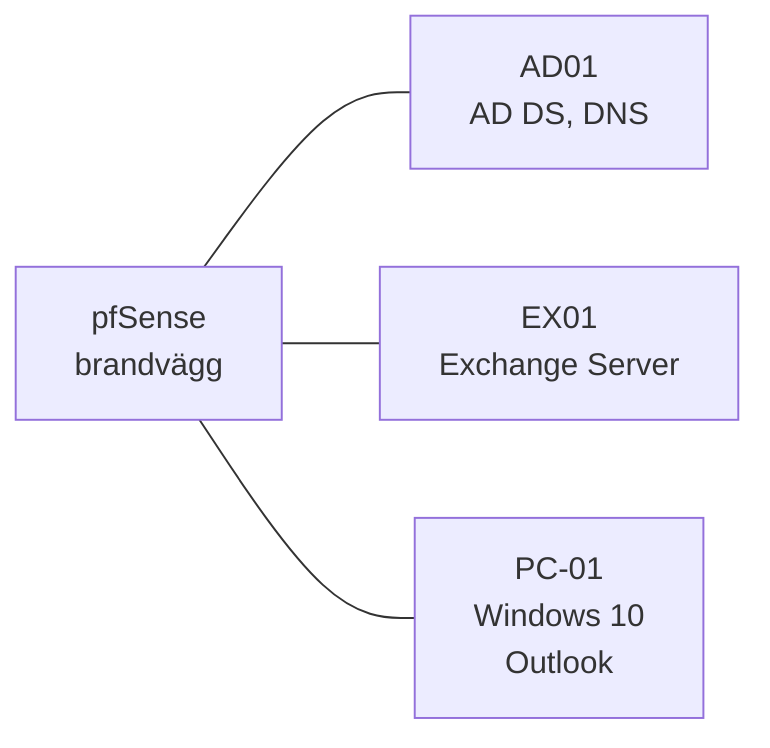
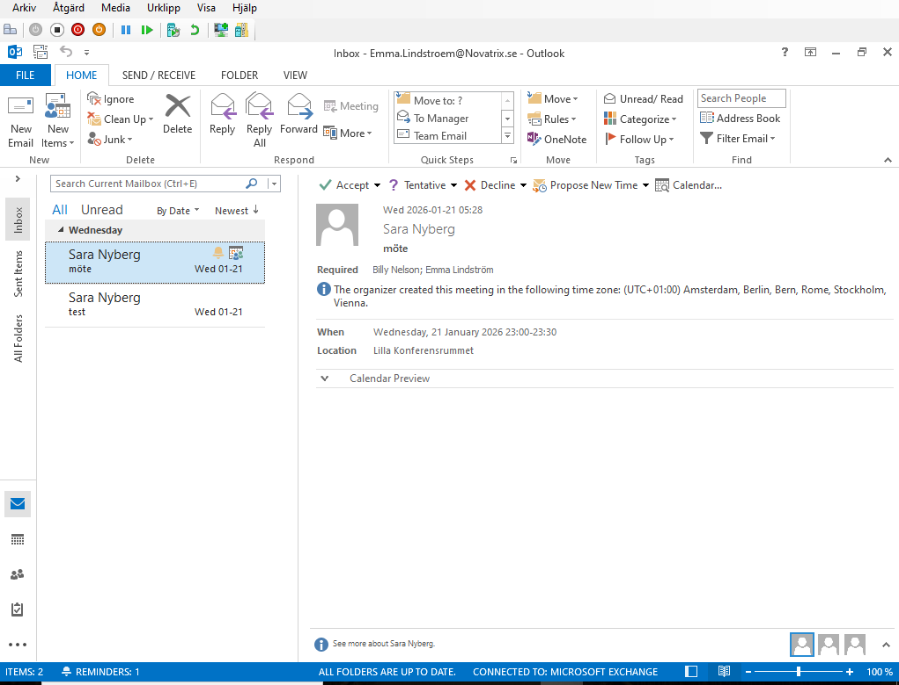
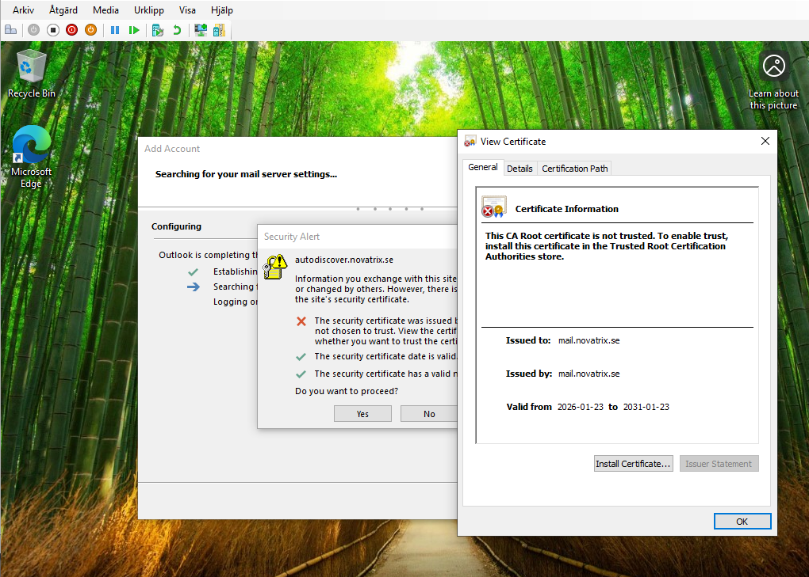

# Exchange-labb – Novatrix

En Exchange-miljö för Novatrix med mailboxar, delad mailbox, distributionsgrupp, bokningsbara resurser och en extra e-postdomän. Allt är verifierat från en Outlook-klient och i Outlook på webben. Labbet gjordes i Exchange-kursen (Projekt IT-infrastruktur del 13, januari 2026).

**Typ:** individuell uppgift.

> Domänerna `novatrix.se` och `provatrix.se` och alla användare är fiktiva labbdata.

## Miljö

| Maskin | Roll |
| --- | --- |
| pfSense | Brandvägg |
| AD01 | Domänkontrollant |
| EX01 | Exchange Server |
| PC-01 | Windows 10-klient med Office |

## Vad som byggdes

| Objekt | Syfte |
| --- | --- |
| Användare i AD med mailboxar i Exchange | Vanlig e-post |
| En delad mailbox, **Support** | Flera användare läser och skickar från samma adress |
| En distributionsgrupp, **Systemalerts** | En adress som når flera mottagare |
| Tre mötesrum som resursmailboxar | Bokas från Outlook och accepterar automatiskt |
| En bokningsbar lastbil | Resursmailbox som bokas som ett mötesrum |
| En extra accepterad domän, `provatrix.se` | Tilldelad en användare som extra adress |

## Verifiering

| Test | Resultat | Skärmbild |
| --- | --- | --- |
| E-post mellan två interna användare | Levererades och kunde läsas | [01](screenshots/01-intern-epost.png) |
| E-post till distributionsgruppen | Meddelandet kom fram till gruppens medlemmar | [02](screenshots/02-distributionsgrupp.png) |
| Delad mailbox | Visades automatiskt för användaren med behörighet | [03](screenshots/03-delad-mailbox.png) |
| Skicka från den delade mailboxen | Mottagaren såg Support som avsändare | [04](screenshots/04-skicka-fran-delad-mailbox.png) |
| Boka mötesrum | Rummet accepterade bokningen automatiskt | [05](screenshots/05-motesrum-bokning.png) |
| Outlook på klienten | Konfigurerades automatiskt med Autodiscover och visar *Connected to Microsoft Exchange* | [07](screenshots/07-outlook-ansluten.png) |
| Extra domän | Användaren har adresser i båda domänerna | [08](screenshots/08-extra-doman-adresser.png) |
| Skicka från den extra domänen | Levererades till en intern mottagare | [09](screenshots/09-extra-doman-skickat.png), [10](screenshots/10-extra-doman-mottaget.png) |

*Outlook på klienten, konfigurerad via Autodiscover, med statusen Connected to Microsoft Exchange.*

## Certifikatvarningen

När Outlook konfigurerades varnade klienten för certifikatet på `autodiscover.novatrix.se`. Exchange använde sitt självsignerade certifikat (`mail.novatrix.se`, utfärdat av sig självt), och klienten litar inte på det.

I en riktig miljö löser man det med ett certifikat från en betrodd utfärdare, eller med en intern CA vars rotcertifikat distribueras till klienterna via GPO. Det är beskrivet här vid portföljarbetet; underlaget visar inte om varningen åtgärdades i labbet.

## Begrepp

Från tentan i Exchange-kursen:

| Begrepp | Förklaring |
| --- | --- |
| `Setup /PrepareSchema` | Utökar AD-schemat med de klasser och attribut som Exchange behöver |
| `Setup /PrepareAD /OrganizationName:<namn>` | Skapar Exchange-organisationens containrar och objekt i AD |
| `Setup /PrepareAllDomains` | Förbereder alla domäner i skogen för Exchange |
| Delad mailbox | En postlåda som flera användare öppnar och skickar från |
| Distributionsgrupp | En gruppadress som skickar till flera mottagare, utan delad postlåda |
| Public folder | En gemensam mappstruktur för e-post och filer i organisationen |
| Send Connector | Talar om för Exchange hur och vart e-post till externa domäner ska skickas |
| SPF | DNS-post som listar vilka servrar som får skicka e-post för domänen |
| DKIM | Digital signatur som visar att meddelandet inte ändrats på vägen |
| DMARC | Policy som talar om för mottagaren vad den ska göra om SPF eller DKIM inte stämmer – skydd mot spoofing och phishing |
