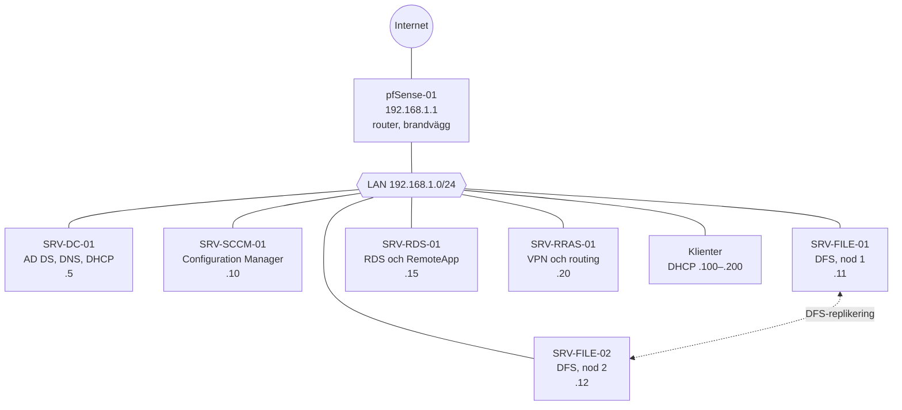
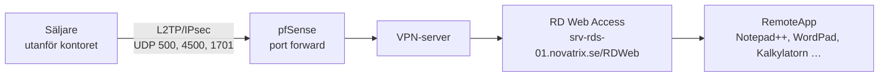
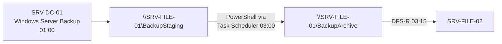

# Novatrix On-Prem Infrastructure Build

En serverbaserad miljö för Novatrix: Active Directory, DFS på två filservrar, Remote Desktop Services med RemoteApp, VPN för säljarna, SCCM för compliance, säkerhets-GPO:er och nattlig backup. Projektet gjordes i kursen Microsoft Server (november 2025).

**Typ:** gemensamt grupparbete med två gruppmedlemmar, där alla deltog i alla delar.

> Domänen `novatrix.se` och alla användare är fiktiva labbdata.

## Mål

Novatrix ska kunna växa, fungera även när internet ligger nere och ha behörigheter som följer varje avdelnings roll.

## Arkitektur

| Server | IP-adress | Roll |
| --- | --- | --- |
| pfSense-01 | 192.168.1.1 | Router och brandvägg. DHCP avstängt. |
| SRV-DC-01 | 192.168.1.5 | Domänkontrollant, DNS och DHCP |
| SRV-SCCM-01 | 192.168.1.10 | System Center Configuration Manager |
| SRV-FILE-01 | 192.168.1.11 | DFS-filserver, nod 1 |
| SRV-FILE-02 | 192.168.1.12 | DFS-filserver, nod 2 |
| SRV-RDS-01 | 192.168.1.15 | Remote Desktop Services |
| SRV-RRAS-01 | 192.168.1.20 | Routing and Remote Access |

## Active Directory

Rot-OU `novatrix` med `Admins`, `Security Groups`, `Service Accounts`, `Computers` (Servers, Workstations) och `Users` (Ekonomi, IT, Lager, Ledning, Marknad, Sälj, Unassigned).

| Grupp | Medlemmar | Ger |
| --- | --- | --- |
| SEC_SALES, SEC_MARKETING, SEC_IT, SEC_LOGISTICS, SEC_FINANCE, SEC_MANAGEMENT | Respektive avdelning | Avdelningens mappar och system |
| SEC_COMMON | Alla avdelningsgrupper, inga användare direkt | Gemensamma resurser |
| SEC_VPN_USER | SEC_SALES | VPN-åtkomst |
| SEC_RDS_USER | SEC_SALES | RDS-åtkomst |

## DFS och avdelningsmappar

Mapparna nås via domänens namnrymd, till exempel `\\novatrix.se\Ekonomi`, och mappas som nätverksenheter med Drive Maps i en GPO. Varje avdelningsgrupp har Full Control på sin mapp. `Gemensam` är öppen för alla med läs- och skrivrätt. Två filservrar replikerar med DFS-R.

## Group Policy

| GPO | Inställning | Syfte |
| --- | --- | --- |
| Standard Wallpaper | Desktop Wallpaper från `\\SRV-FILE-01\Distribution\Assets\Wallpaper`, stil Fill | Enhetlig arbetsmiljö |
| USB-Blockering | *All Removable Storage Classes: Deny all access*, länkad till dator-OU:n | Stoppa dataläckor och skadlig kod via USB, med undantag för IT |
| Standard Password Policy | Historik 5, max 60 dagar, min 1 dag, minst 8 tecken, komplexitet på, ingen reversibel kryptering | Starka lösenord |
| Brandväggspolicy – Workstations | Domänprofilen på, med regler för SMB, WMI och ICMP Echo | Interna tjänster ska fungera |
| RDS Root Cert | Serverns självsignerade certifikat i *Trusted Root Certification Authorities* | Ingen certifikatvarning mot RDS |
| RDS Feed Settings | *Specify default connection URL* = RemoteApp-feeden | RemoteApp-programmen visas i Startmenyn |

> **Rättelse vid portföljarbetet – USB-undantaget:** dokumentationen säger att undantaget för IT görs genom att filtrera GPO:n på användargruppen SEC-IT. Inställningen ligger under *Computer Configuration*, och säkerhetsfiltrering på en datorprincip avgör vilka **datorer** som får den, inte vilka användare. Undantaget behöver därför göras med en grupp av IT-datorer, eller med motsvarande inställning under *User Configuration* filtrerad på SEC-IT.

> **Säkerhetsaspekt som gruppen själv lyfte:** brandväggs-GPO:n tillåter inkommande trafik på domänprofilen. Det gör interna tjänster enkla men ökar risken om en arbetsstation blir komprometterad.

## RDS och VPN

- **VPN:** L2TP/IPsec med autentisering mot AD, bara för SEC_SALES. pfSense vidarebefordrar UDP 500 (ISAKMP), 4500 (NAT-T) och 1701 (L2TP), och portarna är öppnade i Windows-brandväggen.
- **RDS:** SRV-RDS-01 med Session Host, Connection Broker och Web Access. RDS nås inte från internet utan bara via VPN.
- **Certifikat:** ett självsignerat certifikat för `srv-rds-01.novatrix.se` skapades i *Edit Deployment Properties* och distribuerades till klienterna med GPO.
- **Verifiering enligt dokumentationen:** klienterna har certifikatet bland betrodda rotcertifikat, RemoteApp-programmen syns i Startmenyn under *Work Resources*, och ingen certifikatvarning visas mot RD Web Access.

> **Oklarhet i dokumentationen:** IP-planen har en egen VPN-server, SRV-RRAS-01 (.20), men port forward-reglerna och VPN-avsnittet pekar på SRV-DC-01 (.5). Vilken server som till slut körde VPN framgår inte. Rolltabellen nämner dessutom RD Gateway för åtkomst utan VPN, vilket motsäger att RDS bara nås via VPN.

## SCCM – compliance

Två konfigurationsobjekt (Configuration Items) i compliance-baselines, distribuerade till en enhetssamling med en Windows 10- och en Windows 11-klient:

| Baseline | Registervärde | Förväntat |
| --- | --- | --- |
| Brandvägg på | `HKLM\SYSTEM\CurrentControlSet\Services\SharedAccess\Parameters\FirewallPolicy\StandardProfile\EnableFirewall` | `1` |
| Automatiska uppdateringar | `HKLM\SOFTWARE\Policies\Microsoft\Windows\WindowsUpdate\AU\NoAutoUpdate` | `0` |

**Resultat:** först visades 0 % compliant. Efter *Machine Policy Retrieval & Evaluation Cycle* och *Compliance Evaluation* på klienterna visades brandväggen som aktiv på alla maskiner.

> **Rättelse:** baselinen för brandväggen hette "Defender Active" i dokumentationen, men den kontrollerar Windows-brandväggen, inte Microsoft Defender Antivirus.

## Backup

Ett skript hittar den senaste backupen och kopierar den till arkivet med servernamn och datum i filnamnet. DFS-R speglar arkivet till SRV-FILE-02, så det finns alltid två kopior på olika servrar. Skriptet finns inte med i underlaget.

## Lärdomar

- **Grupper i grupper** (SEC_COMMON, SEC_VPN_USER) gör behörigheter lätta att ändra när en avdelning får nya rättigheter.
- **En compliance-baseline visar 0 %** tills klienterna har hämtat policyn och utvärderat. Den ska inte tolkas förrän cykeln har körts.
- **Säkerhetsfiltrering på en GPO** måste matcha var inställningen ligger, i dator- eller användardelen. Det upptäcktes vid granskningen inför portföljen.
